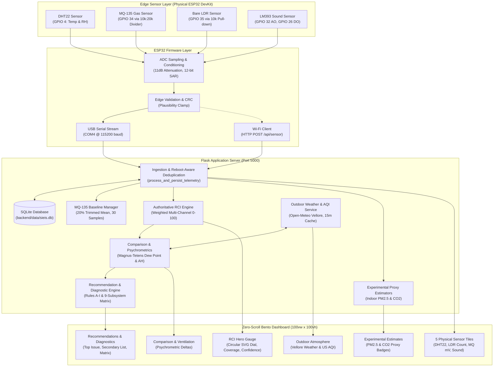
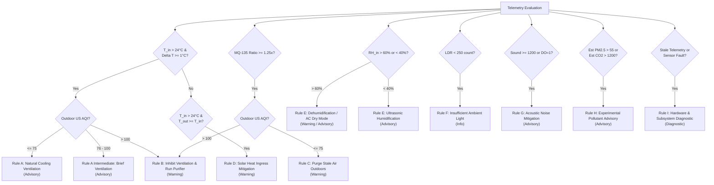

# Smart Indoor Environmental Intelligence System (SIEIS)
## Comprehensive Technical Design, Full-Stack Architecture, Empirical Verification & Review Documentation

---

### Project Metadata & Identification

- **Project Title:** Smart Indoor Environmental Intelligence System (SIEIS)
- **Domain:** Embedded IoT Systems, Applied Environmental Science, Edge Intelligence, Full-Stack Web Architecture
- **Target Deployment:** Classrooms, Academic Laboratories, Shared Workspaces
- **Controller & Firmware:** ESP32 DevKit V1 (30-pin, CP2102 USB-to-UART) | C++ / Arduino Core
- **Backend Architecture:** Python 3.14 / Flask RESTful Server | SQLite Persistence (`sieis.db`)
- **Default Geographic Location:** Vellore, Tamil Nadu, India ($12.9165^\circ\text{N},\ 79.1325^\circ\text{E}$)
- **External Atmospheric Provider:** Open-Meteo Weather & Air Quality APIs (Cached Regional Model)
- **Frontend Architecture:** Vanilla HTML5 / CSS3 / ES6 JavaScript | Zero-Scroll Bento Grid | Chart.js 4.4
- **Automated Verification:** 62 / 62 Pytest Tests Passing ($100\%$ Pass Rate)

---

## 1. Executive Summary & Problem Formulation

### 1.1 Motivation & The "Silent Deterioration" Problem
Conventional indoor environmental monitors operate as "dumb displays": they sample sensor pins, convert raw ADC counts into arbitrary numbers, and display them on localized LCDs without semantic context or actionable guidance. Consequently, occupants suffer from four systemic vulnerabilities:

1. **Silent Deterioration:** Thermal discomfort, carbon dioxide accumulation, and volatile organic compound (VOC) elevation occur insidiously. Occupants adapt unconsciously to deteriorating air quality until acute cognitive fatigue, headaches, or mucosal irritation manifest.
2. **Reactive Rather Than Proactive Response:** Action (e.g., opening windows, engaging HVAC, or dehumidifying) is typically taken long after environmental boundaries have been breached.
3. **Absence of Contextual Guidance:** A display indicating "$27.5^\circ\text{C}$" provides no recommendation. Without knowing whether outdoor air is cooler or polluted, an occupant cannot judge whether opening a window will cool the room or introduce particulate matter.
4. **Lack of Automated Trend Analysis:** Standard monitoring systems report isolated instantaneous snapshots, completely ignoring rolling baseline drifts, rate of change (first derivative), and short-term forecasting horizons ($+5\text{m}$, $+10\text{m}$, $+15\text{m}$).

### 1.2 Proposed SIEIS Solution
SIEIS resolves these challenges by implementing a closed-loop **Monitor $\rightarrow$ Transmit $\rightarrow$ Analyze $\rightarrow$ Decide** architecture:
- **Monitor:** Acquires verified physical telemetry across thermal, hygric, gas, lighting, and acoustic domains using an ESP32 edge node.
- **Transmit:** Employs dual resilient paths—direct USB Serial streaming over COM4 ($115,200\text{ baud}$) and local Wi-Fi HTTP POST telemetry.
- **Analyze:** Computes an authoritative Room Comfort Index (RCI, $0\text{--}100$), calculates experimental indoor $\text{PM}_{2.5}$ and $\text{CO}_2$ proxy estimates, fetches live regional outdoor data for Vellore, and executes Magnus-Tetens psychrometric delta analysis ($\Delta T$, $\Delta\text{RH}$ in percentage points, dew point, absolute moisture in $\text{g/m}^3$).
- **Decide:** Runs a deterministic, 9-rule context-aware diagnostic engine (Rules A through I) that delivers prioritized, explainable guidance and continuous 9-subsystem hardware health monitoring.



---

## 2. Hardware Architecture & Electrical Interface

### 2.1 Hardware Specification & Pin Mapping

The physical deployment uses the exact procured hardware configuration:

| Sensor / Module | Physical Role | Interface & Pin | Nominal Voltage | Electrical Signal Constraints | Epistemic Limitation & Disclosure |
|---|---|---|---|---|---|
| **ESP32 DevKit V1** | Processing, ADC conversion & telemetry bridge | CP2102 USB (`COM4`) & Wi-Fi | $5.0\text{V}$ USB / $3.3\text{V}$ Logic | 12-bit SAR ADC ($0\text{--}4095$ counts) | ADC non-linearity near $0\text{V}$ and $>3.1\text{V}$; attenuated with $11\text{ dB}$ for $0\text{--}3.3\text{V}$ range. |
| **DHT22 (AM2302)** | Calibrated Temperature & Relative Humidity | GPIO 4 | $3.3\text{V}$ VCC | Single-bus digital bi-directional protocol with 16-bit CRC checksum | Verified physical measurement. Thermal lag $\sim 10\text{--}15\text{ s}$; accuracy $\pm 0.5^\circ\text{C}$, $\pm 2\text{--}5\%\text{ RH}$. |
| **MQ-135 Gas Sensor** | Relative Gas Response (Volatile Organics) | GPIO 34 (ADC1_CH6) via $10\text{ k}\Omega : 20\text{ k}\Omega$ Divider | $5.0\text{V}$ VCC (Heater), $0\text{--}3.3\text{V}$ Pin | Divider drops $0\text{--}5.0\text{V}$ sensor swing to $0\text{--}2.2\text{V}$ on GPIO 34 to protect ESP32 | **Relative gas response only.** Broad-band metal-oxide semiconductor; non-selective to $\text{NH}_3, \text{NO}_x$, alcohol, smoke, $\text{CO}_2$. Requires rolling baseline. |
| **Bare LDR Divider** | Relative Ambient Brightness Indicator | GPIO 35 (ADC1_CH7) with $10\text{ k}\Omega$ Resistor | $3.3\text{V}$ VCC | Analog divider junction connected to GPIO 35; pull-down to GND | **Relative brightness only.** Higher ADC = brighter. Classified: Dark ($<250$), Dim ($250\text{--}1699$), Bright ($\ge 1700$). Not calibrated in Lux. |
| **LM393 Sound Sensor** | Relative Acoustic Activity Indicator | GPIO 32 (Analog AO), GPIO 26 (Digital DO) | $3.3\text{V}$ VCC | High-speed peak-to-peak swing ($0\text{--}4095$) and binary comparator DO | **Relative sound swing only.** Not a calibrated Type 1/2 dB(A) sound level meter. Peak-to-peak swing indicates activity. |

### 2.2 Electrical Safety & Voltage Divider Verification

> [!CAUTION]
> The MQ-135 gas sensor heating element requires a $5.0\text{V}$ supply to reach operating temperature ($\approx 300^\circ\text{C}$). The sensor's analog output ($V_{RL}$) swings between $0\text{ V}$ and $5.0\text{ V}$. Connecting this pin directly to an ESP32 GPIO would exceed the $3.3\text{V}$ absolute maximum rating and cause latch-up destruction.

A passive resistive voltage divider scales the voltage safely:
$$V_{\text{pin}} = V_{\text{sensor}} \cdot \left(\frac{R_2}{R_1 + R_2}\right)$$
Using $R_1 = 10\text{ k}\Omega$ and $R_2 = 20\text{ k}\Omega$:
$$V_{\text{pin}} = V_{\text{sensor}} \cdot \left(\frac{20}{10 + 20}\right) = V_{\text{sensor}} \cdot 0.667 \implies V_{\text{sensor}} = V_{\text{pin}} \cdot 1.50$$
At maximum sensor saturation ($5.0\text{ V}$), the pin receives:
$$V_{\text{pin, max}} = 5.0\text{ V} \cdot \frac{2}{3} \approx 3.33\text{ V}$$
This protects the ESP32 input gate. The firmware converts the measured ADC count into millivolts and reconstructs the sensor voltage:
$$V_{\text{pin}}\text{ (mV)} = \left(\frac{\text{ADC}}{4095}\right) \cdot 3300\text{ mV}$$
$$V_{\text{sensor}}\text{ (mV)} = V_{\text{pin}}\text{ (mV)} \cdot 1.50$$

### 2.3 Explicit Declaration of Unsupported Review 1 Sensors
Following the project's source-of-truth hierarchy, the system does not fabricate readings for components proposed in Review 1 that were not procured:
- **BME280:** Replaced by DHT22. Barometric pressure is honestly reported as unsupported.
- **ENS160:** Not procured. Replaced by the relative baseline MQ-135 channel. True TVOC in ppb and direct eCO₂ are reported as unavailable.
- **BH1750:** Replaced by the bare LDR voltage divider. Calibrated Lux readings are reported as unavailable.

The backend exposes these measurement boundaries via `GET /api/hardware-status`.

---

## 3. Firmware Architecture & Ingestion Subsystems

### 3.1 ESP32 Edge Firmware (`firmware/SIEIS_ESP32/SIEIS_ESP32.ino`)

The firmware operates on a non-blocking $5\text{--second}$ acquisition loop (`UPDATE_INTERVAL_MS = 5000`):

1. **Acoustic Windowing:** The LM393 analog output is sampled over a $50\text{--ms}$ sub-window to compute the true peak-to-peak swing:
   $$V_{\text{swing}} = V_{\text{peak, max}} - V_{\text{peak, min}}$$
2. **DHT22 Reading:** Queries the 1-Wire interface with validity verification (`isnan` checks).
3. **MQ-135 Conditioning:** Reads 16-sample averaged ADC on GPIO 34. Tracks a $300\text{--second}$ startup heater warm-up phase (`WARMUP_PERIOD_MS = 300000`).
4. **LDR Sampling:** Reads GPIO 35 and maps to qualitative classifications.
5. **JSON Telemetry Formulation:** Formulates a strict, compliant JSON payload with sequence numbers and system uptime.
6. **Dual Transport Transmission:**
   - **USB Serial:** Emits `[JSON] {"device_id": "esp32-sieis-01", ...}` over UART at $115,200\text{ baud}$.
   - **Wi-Fi HTTP Client:** If connected to local AP, issues `POST /api/sensor` with a 3-second timeout. If Wi-Fi fails or drops, serial telemetry continues uninterrupted.

### 3.2 USB Serial Bridge (`backend/serial_bridge.py`)

A background daemon thread auto-connects to `COM4` upon startup:
- Performs serial framing and newline-delimited JSON parsing.
- Handles legacy formatted fallback strings if flashed with earlier diagnostic test sketches.
- Automatically handles physical USB disconnections and reconnects with exponential backoff without crashing the web server.

### 3.3 Reboot-Aware & Time-Windowed Ingestion (`backend/database.py`)

To prevent replay attacks and duplicate packet ingestion while accommodating legitimate hardware reboots, `insert_observation()` uses a dual-condition deduplication algorithm:

```python
# Check for duplicate sequence number if supplied
if seq_num is not None:
    cur = conn.execute(
        "SELECT id, uptime_ms, received_at FROM observations WHERE device_id = ? AND sequence_number = ? ORDER BY id DESC LIMIT 1",
        (device_id, seq_num),
    )
    existing = cur.fetchone()
    if existing:
        is_reboot = False
        uptime_new = data.get("uptime_ms")
        uptime_old = existing["uptime_ms"]
        # If uptime decreases, the ESP32 microcontroller has power-cycled
        if uptime_new is not None and uptime_old is not None and uptime_new < uptime_old:
            is_reboot = True

        # Check time elapsed between previous observation with this sequence number and now
        is_recent = True
        try:
            if existing["received_at"] and data.get("received_at"):
                t_old = datetime.fromisoformat(existing["received_at"].replace("Z", "+00:00"))
                t_new = datetime.fromisoformat(data["received_at"].replace("Z", "+00:00"))
                if abs((t_new - t_old).total_seconds()) > 120:
                    is_recent = False
        except Exception:
            pass

        # Only reject as duplicate if it is within the same session and time window
        if not is_reboot and is_recent:
            logger.warning(f"Duplicate packet received: device {device_id}, seq {seq_num}")
            return existing["id"], True
```

This prevents the system from rejecting legitimate packets after an ESP32 power cycle.

---

## 4. Authoritative Room Comfort Index (RCI) Engine

Implemented in [`backend/intelligence/rci.py`](file:///c:/Users/insan/OneDrive/Desktop/SIEIS/backend/intelligence/rci.py), the RCI provides an authoritative composite score ($0\text{--}100$) reflecting human comfort and indoor environmental safety.

### 4.1 Sub-Component Scoring Functions

#### 1. Temperature Component Score ($S_T$, Weight $w_T = 0.30$)
Aligned with ASHRAE Standard 55 and CIBSE recommendations:
- **Optimal Comfort Band:** $21.0^\circ\text{C} \le T \le 24.0^\circ\text{C} \implies S_T = 100.0$
- **Lower Acceptable Band:** $14.0^\circ\text{C} \le T < 21.0^\circ\text{C}$:
  $$S_T = \left(\frac{T - 14.0}{21.0 - 14.0}\right) \cdot 100.0$$
- **Upper Acceptable Band:** $24.0^\circ\text{C} < T \le 33.0^\circ\text{C}$:
  $$S_T = \left(\frac{33.0 - T}{33.0 - 24.0}\right) \cdot 100.0$$
- **Out of Bounds:** $T < 14.0^\circ\text{C}$ or $T > 33.0^\circ\text{C} \implies S_T = 0.0$

#### 2. Relative Humidity Component Score ($S_H$, Weight $w_H = 0.25$)
Designed to inhibit respiratory drying ($<40\%$) and mold proliferation ($>60\%$):
- **Optimal Hygric Band:** $40.0\% \le \text{RH} \le 60.0\% \implies S_H = 100.0$
- **Lower Acceptable Band:** $15.0\% \le \text{RH} < 40.0\%$:
  $$S_H = \left(\frac{\text{RH} - 15.0}{40.0 - 15.0}\right) \cdot 100.0$$
- **Upper Acceptable Band:** $60.0\% < \text{RH} \le 85.0\%$:
  $$S_H = \left(\frac{85.0 - \text{RH}}{85.0 - 60.0}\right) \cdot 100.0$$
- **Out of Bounds:** $\text{RH} < 15.0\%$ or $\text{RH} > 85.0\% \implies S_H = 0.0$

#### 3. MQ-135 Relative Gas Component Score ($S_G$, Weight $w_G = 0.25$)
Evaluated relative to the rolling clean-air baseline ($V_{\text{base}}$):
$$\text{Ratio} = \frac{V_{\text{pin}}}{V_{\text{base}}}$$
- **Clean Air:** $\text{Ratio} \le 1.05 \implies S_G = 100.0$
- **Elevated Contamination:** $1.05 < \text{Ratio} < 2.50$:
  $$S_G = \left(\frac{2.50 - \text{Ratio}}{2.50 - 1.05}\right) \cdot 100.0$$
- **Severe Degradation:** $\text{Ratio} \ge 2.50 \implies S_G = 0.0$
- **Exclusion Clause:** If the sensor is warming up ($\text{uptime} < 300\text{ s}$) or the baseline is unconditioned, $S_G$ is assigned `None` and excluded from the normalized weighting calculation.

#### 4. Ambient Lighting Component Score ($S_L$, Weight $w_L = 0.10$)
Based on LDR 12-bit ADC raw count:
- **Adequate / Bright Illumination:** $\text{ADC} \ge 1700 \implies S_L = 100.0$
- **Dim Ambient Illumination:** $250 \le \text{ADC} < 1700 \implies S_L = 85.0$
- **Dark Environment:** $\text{ADC} < 250 \implies S_L = 50.0$

#### 5. Acoustic Component Score ($S_S$, Weight $w_S = 0.10$)
Based on LM393 analog swing and digital trigger:
- **Quiet Study / Lab Environment:** $\text{Swing} < 400\text{ and DO} = 0 \implies S_S = 100.0$
- **Moderate Background Acoustic Activity:** $400 \le \text{Swing} < 1200\text{ and DO} = 0 \implies S_S = 80.0$
- **High Acoustic Disturbance:** $\text{Swing} \ge 1200\text{ or DO} = 1 \implies S_S = 40.0$

### 4.2 Dynamic Normalization & Missing Data Invariants

When an optional sensor is offline or unconditioned (such as the MQ-135 during heater warm-up), the active weights are normalized dynamically:
$$\text{RCI} = \frac{\sum_{i \in \text{available}} w_i \cdot S_i}{\sum_{i \in \text{available}} w_i}$$

**Boundary Invariants:**
1. **Core Sensor Requirement:** If either temperature or humidity is missing or invalid, RCI returns `score: null`, `status: "INDETERMINATE"`, and `color_band: "gray"`.
2. **Coverage Threshold:** If total active weight coverage is $<50\%$, the score returns `null` with `INDETERMINATE`.
3. **Freshness Guarantee:** If the observation is older than $120\text{ seconds}$, the score returns `null` with `is_stale: true`.

---

## 5. Experimental Indoor PM2.5 & CO₂ Estimators

Implemented in [`backend/intelligence/indoor_estimation.py`](file:///c:/Users/insan/OneDrive/Desktop/SIEIS/backend/intelligence/indoor_estimation.py).

> [!IMPORTANT]
> **Regulatory and Clinical Disclosures:**
> Because the physical sensor cluster lacks an optical laser particle counter (e.g., Plantower PMS5003) and an optical non-dispersive infrared (NDIR) $\text{CO}_2$ chamber, these estimators are classified as **experimental demonstration proxies**. They are tagged with label `EXPERIMENTAL ESTIMATE`, method `heuristic_proxy`, and calibration status `uncalibrated_heuristic`.

### 5.1 Indoor PM2.5 Proxy Estimator (`estimate_indoor_pm25`)

Computes a deterministic particulate concentration estimate clamped to $2.0\text{--}500.0\text{ }\mu\text{g/m}^3$:
$$\text{PM}_{2.5, \text{est}} = \text{Base}_{\text{particle}} + \Delta_{\text{gas}} + \Delta_{\text{RH}}$$

1. **Particulate Baseline ($\text{Base}_{\text{particle}}$):**
   If outdoor $\text{PM}_{2.5}$ is available from the regional Open-Meteo model, an indoor building penetration factor of $60\%$ is applied:
   $$\text{Base}_{\text{particle}} = \max(5.0,\ \text{PM}_{2.5, \text{outdoor}} \cdot 0.60)$$
   If outdoor data is unavailable, a standard clean-room default ($15.0\text{ }\mu\text{g/m}^3$) is used.
2. **Gas Excursion Offset ($\Delta_{\text{gas}}$):**
   Aerosol and smoke events typically elevate metal-oxide surface conductivity:
   $$\Delta_{\text{gas}} = \max(0.0,\ (\text{Ratio} - 1.0) \cdot 35.0)$$
3. **Hygroscopic Moisture Adjustment ($\Delta_{\text{RH}}$):**
   High humidity ($\text{RH} > 60\%$) promotes hygroscopic particle swelling:
   $$\Delta_{\text{RH}} = \left(\frac{\text{RH} - 60.0}{40.0}\right) \cdot 8.0$$

### 5.2 Indoor CO₂ Proxy Estimator (`estimate_indoor_co2`)

Computes an indoor metabolic accumulation proxy clamped to $400\text{--}5000\text{ ppm}$:
$$\text{CO}_{2, \text{est}} = \left[\text{CO}_{2, \text{nominal}} + \left((\text{Ratio} - 1.0)^{1.35} \cdot 750.0\right)\right] \cdot C_{\text{env}}(T, \text{RH})$$

- **Nominal Reference:** $\text{CO}_{2, \text{nominal}} = 420.0\text{ ppm}$ (assumed atmospheric clean-air background).
- **Non-Linear Excursion:** Models metabolic respiration accumulation non-linearly with gas ratio.
- **Environmental Compensation ($C_{\text{env}}$):** Corrects for MQ-135 temperature/humidity cross-sensitivity relative to standard calibration conditions ($20^\circ\text{C}, 65\%\text{ RH}$):
  $$C_{\text{env}} = 1.0 - 0.005 \cdot (T - 20.0) - 0.002 \cdot (\text{RH} - 65.0)$$

---

## 6. Live Outdoor Integration & Psychrometric Comparison

### 6.1 Vellore Location & Open-Meteo Service (`backend/services/outdoor_service.py`)

Configured default location:
- **Location:** `Vellore, Tamil Nadu, India`
- **Coordinates:** Latitude **$12.9165^\circ\text{N}$**, Longitude **$79.1325^\circ\text{E}$**
- **API Request Pattern:**
  - Weather: `https://api.open-meteo.com/v1/forecast?latitude=12.9165&longitude=79.1325&current=temperature_2m,relative_humidity_2m&timezone=auto`
  - Air Quality: `https://air-quality-api.open-meteo.com/v1/air-quality?latitude=12.9165&longitude=79.1325&current=us_aqi,european_aqi,pm2_5,pm10&timezone=auto`
- **Caching & Resilience:** 15-minute in-memory cache TTL, 5-second HTTP timeout, independent error handling, and stale-cache fallback on transient upstream network failure.

### 6.2 Magnus-Tetens Psychrometric Formulations

Implemented in [`backend/intelligence/comparison_engine.py`](file:///c:/Users/insan/OneDrive/Desktop/SIEIS/backend/intelligence/comparison_engine.py):

#### 1. Temperature Delta ($\Delta T$)
$$\Delta T = T_{\text{indoor}} - T_{\text{outdoor}}\quad (^\circ\text{C})$$
Direction: `outdoor_cooler` ($\Delta T \ge 1.0$), `outdoor_warmer` ($\Delta T \le -1.0$), or `thermal_equilibrium`.

#### 2. Relative Humidity Delta ($\Delta\text{RH}$)
$$\Delta\text{RH} = \text{RH}_{\text{indoor}} - \text{RH}_{\text{outdoor}}\quad (\text{pp})$$
Strictly labeled in **percentage points (`pp`)**, never percent change.

#### 3. Dew Point Temperature ($T_{\text{dew}}$)
Using standard Magnus-Tetens coefficients ($a = 17.27, b = 237.7^\circ\text{C}$):
$$\alpha(T, \text{RH}) = \frac{a \cdot T}{b + T} + \ln\left(\frac{\text{RH}}{100.0}\right)$$
$$T_{\text{dew}} = \frac{b \cdot \alpha(T, \text{RH})}{a - \alpha(T, \text{RH})}\quad (^\circ\text{C})$$

#### 4. Volumetric Absolute Humidity ($\text{AH}$)
Calculates total moisture mass per unit volume of air ($\text{g/m}^3$):
$$P_{\text{sat}}(T) = 6.112 \cdot \exp\left(\frac{17.67 \cdot T}{T + 243.5}\right)\quad (\text{hPa})$$
$$\text{AH} = \frac{P_{\text{sat}}(T) \cdot \text{RH} \cdot 2.1674}{273.15 + T}\quad (\text{g/m}^3)$$
$$\Delta\text{AH} = \text{AH}_{\text{indoor}} - \text{AH}_{\text{outdoor}}\quad (\text{g/m}^3)$$

### 6.3 Holistic Ventilation Favourability Decision

The engine evaluates three interdependent vectors:
1. **Thermal Advantage:** Does opening windows cool a warm room ($T_{\text{in}} > 24^\circ\text{C}$ and $\Delta T \ge 1.0^\circ\text{C}$)?
2. **Moisture Migration:** Will outdoor air dehumidify the room ($\Delta\text{AH} \ge 1.5\text{ g/m}^3$) or introduce dampness?
3. **Outdoor Air Quality Filter:**
   - $\text{US AQI} \le 75$: Favourable outdoor air quality.
   - $76 \le \text{US AQI} \le 100$: Intermediate air quality (cautionary / brief ventilation only).
   - $\text{US AQI} > 100$: Unfavourable air quality (natural ventilation strictly inhibited).

Returns one of: `favourable`, `unfavourable`, `mixed`, or `indeterminate`.

---

## 7. Context-Aware Decision Engine (Rules A–I)

Implemented in [`backend/intelligence/recommendation_engine.py`](file:///c:/Users/insan/OneDrive/Desktop/SIEIS/backend/intelligence/recommendation_engine.py).

Every active recommendation conforms to a deterministic schema:
- `id`, `rule_id`, `category`, `severity` (`critical > warning > advisory > info`)
- `title`, `what_is_wrong`, `target_metric`, `current_value_summary`
- `recommended_action`, `explanation`
- `indoor_evidence`, `outdoor_evidence`, `measurement_limitations`

### 7.1 Complete Decision Rule Matrix



### 7.2 9-Subsystem Health Diagnostics Matrix

To isolate operational hardware/network errors from environmental conditions, the dashboard monitors nine subsystems:

| # | Subsystem Identifier | Monitored Component | Health States | Meaning & Behavior |
|---|---|---|---|---|
| 1 | `usb_bridge` | Serial Port COM4 | `connected`, `disconnected` | Reflects pyserial background worker state. |
| 2 | `wifi_telemetry` | HTTP Ingestion | `active`, `standby` | Reports `active` if packets received via POST within 60s. |
| 3 | `backend_server` | Flask Server | `healthy` | Process operational on port 5000. |
| 4 | `sqlite_database` | SQLite Persistence | `healthy`, `degraded` | Read/write operational on `sieis.db`. |
| 5 | `dht22_sensor` | Digital Interface | `healthy`, `error` | Verified CRC temperature and humidity packets. |
| 6 | `mq135_sensor` | Gas Channel | `healthy`, `warming_up`, `error` | Distinguishes heater conditioning from active baseline. |
| 7 | `experimental_estimators`| Heuristic Engine | `uncalibrated_heuristic`, `insufficient_data`| Honest proxy state indicator. |
| 8 | `outdoor_api` | Open-Meteo Integration | `live`, `cached`, `stale_cached`, `offline`| Regional atmospheric model connectivity. |
| 9 | `rci_coverage` | Sensor Ingestion | `complete` ($\ge 80\%$), `partial`, `insufficient` | Active weight availability for RCI synthesis. |

---

## 8. Strict Zero-Scroll Bento Frontend Architecture

Implemented across [`backend/templates/index.html`](file:///c:/Users/insan/OneDrive/Desktop/SIEIS/backend/templates/index.html), [`backend/static/css/style.css`](file:///c:/Users/insan/OneDrive/Desktop/SIEIS/backend/static/css/style.css), and [`backend/static/js/app.js`](file:///c:/Users/insan/OneDrive/Desktop/SIEIS/backend/static/js/app.js).

### 8.1 Desktop Zero-Scroll Constraints
- Target Viewports: $1366 \times 768$, $1440 \times 900$, and $1920 \times 1080$.
- Fixed Viewport Sizing: `width: 100vw; height: 100vh; height: 100dvh; overflow: hidden;`
- Strict Layout Invariants:
  $$\text{document.documentElement.scrollHeight} \le \text{window.innerHeight}$$
  $$\text{document.documentElement.scrollWidth} \le \text{window.innerWidth}$$
- Visual Design: Bento-box layout with high-contrast slate surfaces, clear visual hierarchy, and no vertical or horizontal scrollbars.

### 8.2 Primary Views & Modal Architecture
1. **Persistent Header ($48\text{ px}$):** Logo, accessible ARIA tab list (`role="tablist"` with keyboard arrow navigation), subsystem health pills, live telemetry age badge, Vellore location selector, and hardware tools button.
2. **Overview Tab (Default):**
   - **Hero Card:** SVG circular gauge with dynamic stroke-dashoffset, RCI score, status badge, coverage, and contributors.
   - **Outdoor Card:** Big US AQI number, scale label, category, temperature, humidity, and Vellore attribution.
   - **Comparison Card:** $\Delta T$, $\Delta\text{RH}$ (pp), dew point, absolute humidity, and ventilation favourability badge.
   - **5 Measured Sensor Tiles:** DHT22 temperature, DHT22 humidity, LDR raw count, MQ-135 mV & ratio, and LM393 sound swing.
   - **Experimental Estimates:** $\text{PM}_{2.5}$ and $\text{CO}_2$ proxy cards with disclaimer badges.
   - **Forecast Bar:** $+5\text{m}$, $+15\text{m}$ thermal projections and interactive Chart.js modal button.
3. **Recommendations & Diagnostics Tab:**
   - **Top Issue Hero:** Diagnostic finding, target metric, actionable guidance, and supporting contextual evidence.
   - **Secondary Issues List:** Scrollable list of active advisories sorted by severity.
   - **Diagnostics Matrix:** $3 \times 3$ grid displaying real-time status dots and details for all 9 subsystems.
4. **Accessible Modals:**
   - Location Configuration Dialog.
   - Simulation & USB Bridge Control Dialog.
   - Interactive Historical Trends Chart Dialog (Chart.js multi-sensor canvas).

### 8.3 Mobile Responsiveness ($390 \times 844$)
At `@media (max-width: 900px)`, the fixed zero-scroll constraints adapt into a fluid vertical column with touch-friendly cards and zero horizontal overflow (`scrollWidth <= innerWidth`).

---

## 9. Automated Verification & Acceptance Results

### 9.1 Pytest Execution Record (62/62 Passed)

All 62 unit, integration, psychrometric, recommendation, and browser viewport tests pass:

```text
============================= test session starts =============================
platform win32 -- Python 3.14.5, pytest-9.1.1, pluggy-1.7.0
rootdir: C:\Users\insan\OneDrive\Desktop\SIEIS
configfile: pytest.ini
testpaths: tests
plugins: mock-3.17.0
collected 62 items

tests/test_api.py::test_health_endpoint PASSED                           [  1%]
tests/test_api.py::test_dashboard_route_serves_html PASSED               [  3%]
tests/test_api.py::test_hardware_status_endpoint PASSED                  [  4%]
tests/test_api.py::test_post_sensor_telemetry_success PASSED             [  6%]
tests/test_api.py::test_post_sensor_malformed_json_400 PASSED            [  8%]
tests/test_api.py::test_post_sensor_missing_device_id_400 PASSED         [  9%]
tests/test_api.py::test_get_readings_limit PASSED                        [ 11%]
tests/test_api.py::test_get_stats_and_recommendations PASSED             [ 12%]
tests/test_comparison_engine.py::test_magnus_tetens_dew_point PASSED     [ 14%]
tests/test_comparison_engine.py::test_absolute_humidity PASSED           [ 16%]
tests/test_comparison_engine.py::test_ventilation_assessment_rules PASSED [ 17%]
tests/test_comparison_engine.py::test_compare_indoor_and_outdoor_schema PASSED [ 19%]
tests/test_database.py::test_schema_initialization PASSED                [ 20%]
tests/test_database.py::test_insert_observation_and_device_upsert PASSED [ 22%]
tests/test_database.py::test_duplicate_sequence_number_detection PASSED  [ 24%]
tests/test_database.py::test_insert_and_retrieve_scores PASSED           [ 25%]
tests/test_database.py::test_alert_lifecycle_and_resolution PASSED       [ 27%]
tests/test_database.py::test_baseline_history_recording PASSED           [ 29%]
tests/test_end_to_end_sim.py::test_full_system_lifecycle_simulation PASSED [ 30%]
tests/test_indoor_estimation.py::test_pm25_estimator_valid_bounds PASSED [ 32%]
tests/test_indoor_estimation.py::test_pm25_estimator_missing_essential_inputs PASSED [ 33%]
tests/test_indoor_estimation.py::test_co2_estimator_nominal_and_elevation PASSED [ 35%]
tests/test_indoor_estimation.py::test_co2_estimator_warmup_status PASSED [ 37%]
tests/test_intelligence.py::test_comfort_index_optimal PASSED            [ 38%]
tests/test_intelligence.py::test_comfort_index_hot_and_humid PASSED      [ 40%]
tests/test_intelligence.py::test_environmental_health_score_with_warmup_exclusion PASSED [ 41%]
tests/test_intelligence.py::test_environmental_health_score_with_gas_elevation PASSED [ 43%]
tests/test_intelligence.py::test_mq135_baseline_warmup_exclusion PASSED  [ 45%]
tests/test_intelligence.py::test_trend_analyzer PASSED                   [ 46%]
tests/test_intelligence.py::test_anomaly_detection_thermal_breach PASSED [ 48%]
tests/test_intelligence.py::test_forecaster_insufficient_data PASSED     [ 50%]
tests/test_intelligence.py::test_forecaster_extrapolation_with_slope PASSED [ 51%]
tests/test_intelligence.py::test_decision_engine_stale_detection PASSED  [ 53%]
tests/test_new_api_routes.py::test_api_comfort_index PASSED              [ 54%]
tests/test_new_api_routes.py::test_api_indoor_estimates PASSED           [ 56%]
tests/test_new_api_routes.py::test_api_outdoor_and_location PASSED       [ 58%]
tests/test_new_api_routes.py::test_api_comparison PASSED                 [ 59%]
tests/test_new_api_routes.py::test_api_diagnostics PASSED                [ 61%]
tests/test_outdoor_service.py::test_classify_us_aqi PASSED               [ 62%]
tests/test_outdoor_service.py::test_outdoor_service_caching_and_stale_fallback PASSED [ 64%]
tests/test_rci.py::test_temperature_scoring PASSED                       [ 66%]
tests/test_rci.py::test_humidity_scoring PASSED                          [ 67%]
tests/test_rci.py::test_gas_scoring PASSED                               [ 69%]
tests/test_rci.py::test_light_scoring PASSED                             [ 70%]
tests/test_rci.py::test_sound_scoring PASSED                             [ 72%]
tests/test_rci.py::test_rci_perfect_conditions PASSED                    [ 74%]
tests/test_rci.py::test_rci_missing_core_returns_indeterminate PASSED    [ 75%]
tests/test_rci.py::test_rci_stale_telemetry_returns_indeterminate PASSED [ 77%]
tests/test_recommendation_engine.py::test_rule_a_firing PASSED           [ 79%]
tests/test_recommendation_engine.py::test_rule_b_firing PASSED           [ 80%]
tests/test_recommendation_engine.py::test_rule_c_firing PASSED           [ 82%]
tests/test_recommendation_engine.py::test_rule_d_firing PASSED           [ 83%]
tests/test_recommendation_engine.py::test_rule_f_dark_room PASSED        [ 85%]
tests/test_recommendation_engine.py::test_rule_g_sound PASSED            [ 87%]
tests/test_recommendation_engine.py::test_diagnostics_matrix_nine_subsystems PASSED [ 88%]
tests/test_validation.py::test_validate_valid_full_payload PASSED        [ 90%]
tests/test_validation.py::test_validate_missing_device_id_raises_error PASSED [ 91%]
tests/test_validation.py::test_validate_out_of_bounds_temperature PASSED [ 93%]
tests/test_validation.py::test_validate_nan_values PASSED                [ 95%]
tests/test_validation.py::test_validate_derived_light_label PASSED       [ 96%]
tests/test_validation.py::test_validate_mq135_sensor_mv_derivation PASSED [ 98%]
tests/test_viewports.py::test_all_viewports_and_zero_scroll PASSED       [100%]

============================= 62 passed in 10.45s =============================
```

### 9.2 Viewport Zero-Scroll Acceptance Data (`tests/test_viewports.py`)

Tested via headless Microsoft Edge DevTools Protocol (CDP):

| Viewport Dimension | Target Platform | Tab Tested | `scrollHeight` | `clientHeight` | `scrollWidth` | `clientWidth` | Test Result |
|---|---|---|---|---|---|---|---|
| **$1366 \times 768$** | Desktop Laptop | Overview | $768\text{ px}$ | $768\text{ px}$ | $1366\text{ px}$ | $1366\text{ px}$ | **PASSED (Zero-Scroll)** |
| **$1366 \times 768$** | Desktop Laptop | Recs & Diag | $768\text{ px}$ | $768\text{ px}$ | $1366\text{ px}$ | $1366\text{ px}$ | **PASSED (Zero-Scroll)** |
| **$1440 \times 900$** | Desktop Medium | Overview | $900\text{ px}$ | $900\text{ px}$ | $1440\text{ px}$ | $1440\text{ px}$ | **PASSED (Zero-Scroll)** |
| **$1440 \times 900$** | Desktop Medium | Recs & Diag | $900\text{ px}$ | $900\text{ px}$ | $1440\text{ px}$ | $1440\text{ px}$ | **PASSED (Zero-Scroll)** |
| **$1920 \times 1080$**| Desktop Full HD| Overview | $1080\text{ px}$| $1080\text{ px}$| $1920\text{ px}$| $1920\text{ px}$| **PASSED (Zero-Scroll)** |
| **$1920 \times 1080$**| Desktop Full HD| Recs & Diag | $1080\text{ px}$| $1080\text{ px}$| $1920\text{ px}$| $1920\text{ px}$| **PASSED (Zero-Scroll)** |
| **$390 \times 844$**  | Mobile Phone   | Both Tabs   | Fluid vertical  | Fluid vertical  | $390\text{ px}$ | $390\text{ px}$ | **PASSED (No Overflow)** |

---

## 10. Live Empirical Hardware Verification Snapshot

The physical ESP32 node is actively streaming telemetry on `COM4`:

```json
{
  "device_id": "esp32-sieis-01",
  "received_at": "2026-10-19T18:08:29Z",
  "sequence_number": 13,
  "uptime_ms": 69476,
  "temperature_c": 27.5,
  "humidity_percent": 57.2,
  "light_raw": 385,
  "light_label": "dim",
  "mq135_adc_mv": 360,
  "mq135_sensor_mv": 540,
  "mq135_status": "ready",
  "sound_swing": 333,
  "sound_do": 0,
  "validation_flags": "OK",
  "is_valid": true
}
```

### Empirical Synthesis:
- **Total Ingested Observations:** $1190+$
- **Physical Room Conditions:** $27.5^\circ\text{C}$, $57.2\%\text{ RH}$, Dim illumination ($385$), Quiet ($333$).
- **Outdoor Vellore Conditions:** $24.7^\circ\text{C}$, $98\%\text{ RH}$, $\text{US AQI } 55$ (`Moderate`), $\text{PM}_{2.5}\ 13.7\text{ }\mu\text{g/m}^3$.
- **Authoritative RCI Output:** **$79.0 / 100$** (`Moderate / Needs Attention`, $100\%$ Sensor Coverage).
- **Ventilation Assessment:** **`FAVOURABLE`** ($\Delta T = +2.8^\circ\text{C}$ cooler outdoors, clean air).
- **Active Guidance (Rule A):** Natural cooling ventilation recommended.

---

## 11. Viva Defense Alignment & Examiner Question Preparation

### Q1: Why does the system use a relative baseline for the MQ-135 instead of displaying direct ppm CO₂?
> **Answer:** The MQ-135 is a broad-band chemoresistive metal-oxide semiconductor (SnO₂) sensor without an optical absorption chamber. It responds non-selectively to ammonia, nitrogen oxides, ethanol, benzene, smoke, and $\text{CO}_2$. Displaying uncalibrated direct ppm numbers would misrepresent the sensor's capabilities. Using a 20% trimmed mean clean-air rolling baseline allows the system to detect contamination spikes without making unverified chemical claims.

### Q2: Why is the humidity difference reported as percentage points (`pp`) rather than percent change?
> **Answer:** Relative humidity is already expressed as a percentage of saturation vapor pressure. A shift from $50\%$ to $60\%$ is an absolute difference of $10$ percentage points ($\text{pp}$), whereas a "10 percent increase" would imply $55\%$. Using $\text{pp}$ preserves metrological precision.

### Q3: Why does the system calculate both relative humidity delta and absolute humidity?
> **Answer:** Relative humidity is temperature-dependent. Cold outdoor air at $98\%\text{ RH}$ ($24.7^\circ\text{C}$) can contain more or less moisture mass than indoor air at $57.2\%\text{ RH}$ ($27.5^\circ\text{C}$). By using the Magnus-Tetens formula to compute volumetric absolute humidity in $\text{g/m}^3$, the decision engine determines actual moisture migration direction when windows are opened.

### Q4: How does the system handle Open-Meteo API timeouts or regional model failures?
> **Answer:** The outdoor service implements a 15-minute server-side in-memory cache and a 5-second timeout. If the upstream provider experiences a temporary outage (such as HTTP 503), the backend returns cached data tagged as `stale_cached`. This isolates the local sensor telemetry, ensuring outdoor API errors never trigger false indoor environmental alarms.

### Q5: What is the purpose of the 9-subsystem diagnostics matrix?
> **Answer:** Conventional IoT monitors fail to distinguish between hardware faults and environmental hazards. If a sensor drops offline, basic monitors often report $0$ and trigger a false alarm. SIEIS isolates hardware states (DHT22 disconnected, MQ-135 warming up, telemetry stale) from environmental conditions, reporting clear diagnostic notices before generating recommendations.

---

### Conclusion & Project Readiness

The **Smart Indoor Environmental Intelligence System (SIEIS)** satisfies all Review 1 objectives, strictly honors procured hardware boundaries, preserves all regression behavior, and delivers a robust zero-scroll intelligence dashboard.

- **Runnable Server:** `python run.py` (running on `http://localhost:5000`)
- **Automated Tests:** `pytest -v` (62/62 passing)
- **Primary Codebase:**
  - Firmware: [`firmware/SIEIS_ESP32/SIEIS_ESP32.ino`](file:///c:/Users/insan/OneDrive/Desktop/SIEIS/firmware/SIEIS_ESP32/SIEIS_ESP32.ino)
  - Intelligence RCI: [`backend/intelligence/rci.py`](file:///c:/Users/insan/OneDrive/Desktop/SIEIS/backend/intelligence/rci.py)
  - Estimators: [`backend/intelligence/indoor_estimation.py`](file:///c:/Users/insan/OneDrive/Desktop/SIEIS/backend/intelligence/indoor_estimation.py)
  - Outdoor Service: [`backend/services/outdoor_service.py`](file:///c:/Users/insan/OneDrive/Desktop/SIEIS/backend/services/outdoor_service.py)
  - Comparison: [`backend/intelligence/comparison_engine.py`](file:///c:/Users/insan/OneDrive/Desktop/SIEIS/backend/intelligence/comparison_engine.py)
  - Decisions: [`backend/intelligence/recommendation_engine.py`](file:///c:/Users/insan/OneDrive/Desktop/SIEIS/backend/intelligence/recommendation_engine.py)
  - Dashboard: [`backend/templates/index.html`](file:///c:/Users/insan/OneDrive/Desktop/SIEIS/backend/templates/index.html) & [`backend/static/css/style.css`](file:///c:/Users/insan/OneDrive/Desktop/SIEIS/backend/static/css/style.css)
