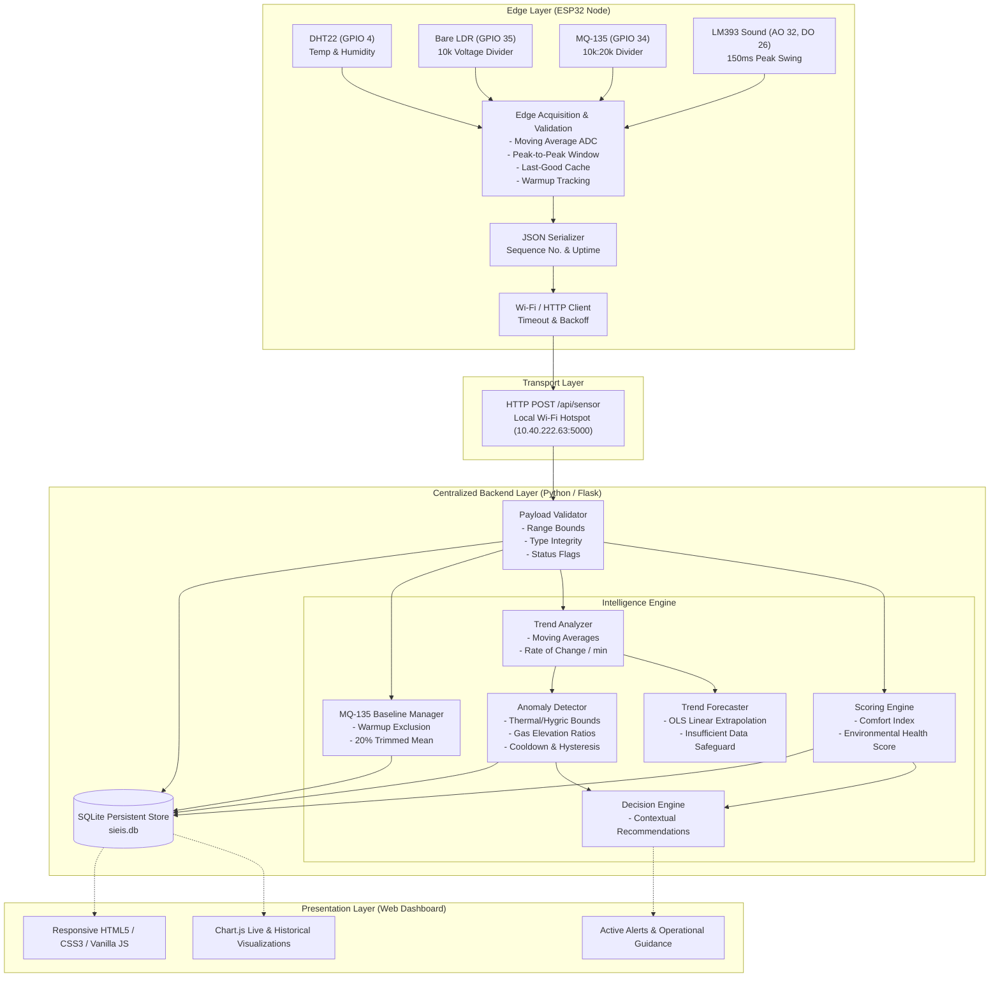
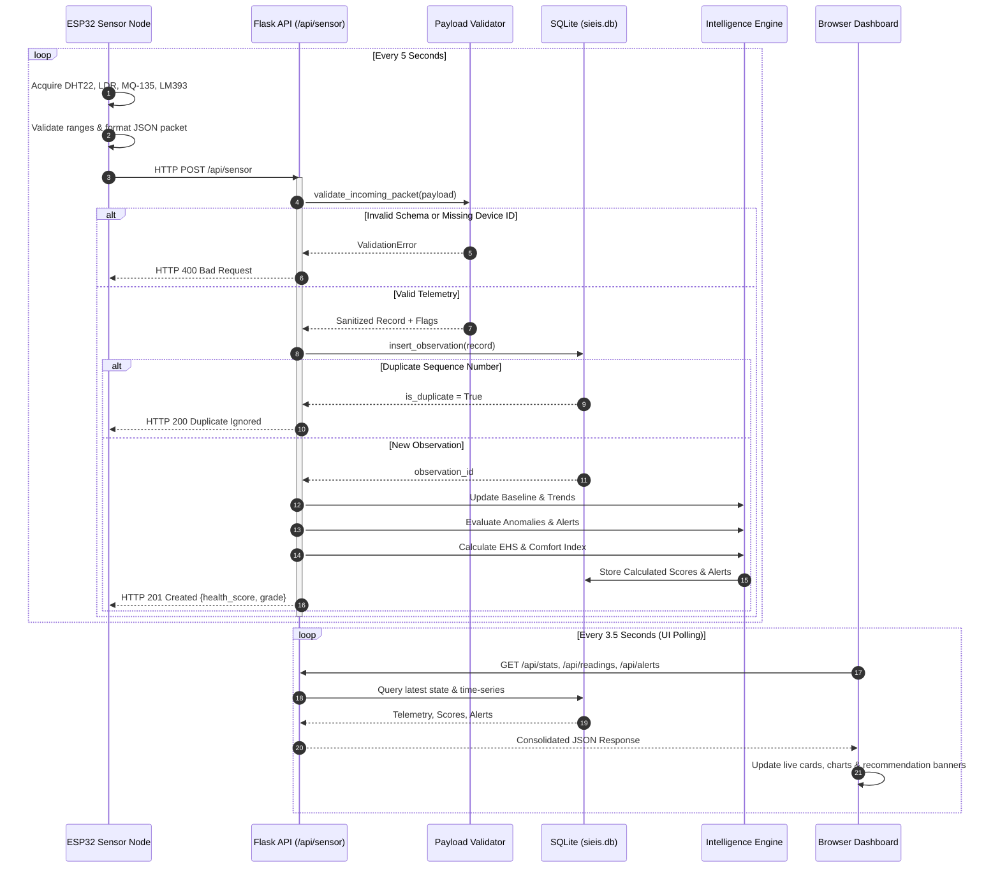

# SIEIS System Architecture Specification

## 1. Executive Summary
The **Smart Indoor Environmental Intelligence System (SIEIS)** is an end-to-end edge-to-cloud architecture designed to transform indoor environmental monitoring from passive data acquisition into proactive, automated decision support.

The system comprises three primary architectural layers:
1. **Edge Acquisition Layer:** An ESP32 microcontroller acquiring physical and relative measurements from four distinct sensor subsystems, performing local validation, JSON formatting, and robust HTTP transport.
2. **Centralized Intelligence Backend:** A modular Python 3.14 / Flask service coupled with persistent SQLite time-series storage, mathematical scoring engines, rolling baseline tracking, anomaly detection, and linear forecasting.
3. **Web Decision Dashboard:** A responsive HTML5/CSS3/Vanilla JS and Chart.js interface delivering real-time telemetry, historical trend graphs, multi-parameter health scores, and actionable recommendations.

---

## 2. System Architecture Flow

---

## 3. Telemetry Ingestion Sequence

---

## 4. Key Architectural Safeguards
1. **Idempotent Ingestion:** The database enforces uniqueness on `(device_id, sequence_number)`, ensuring network retransmissions do not distort historical time-series or rolling baselines.
2. **Warmup Quarantining:** The MQ-135 heater requires 5 minutes of thermal stabilization after power-on. Readings during this period are tagged `warming_up` and strictly excluded from baseline computation and EHS scoring.
3. **Decoupled Execution:** If network connectivity fails, the ESP32 continues local acquisition and diagnostics via USB Serial Monitor without blocking on socket calls.
4. **Transparent Degradation:** When an optional measurement channel is missing (e.g., DHT22 read timeout), the firmware supplies the last known valid reading while flagging the status as `degraded_cached`. The backend incorporates data coverage percentages into its confidence metrics.
